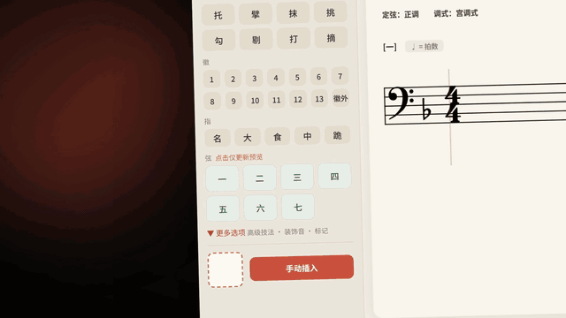
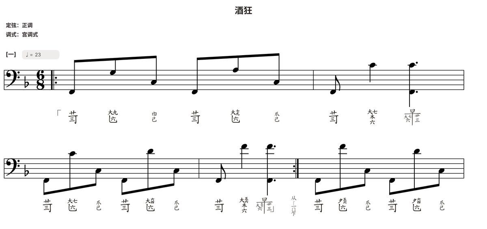
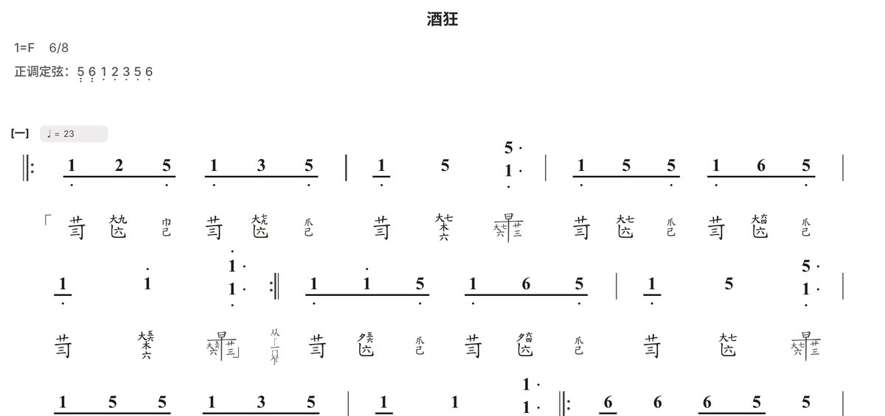
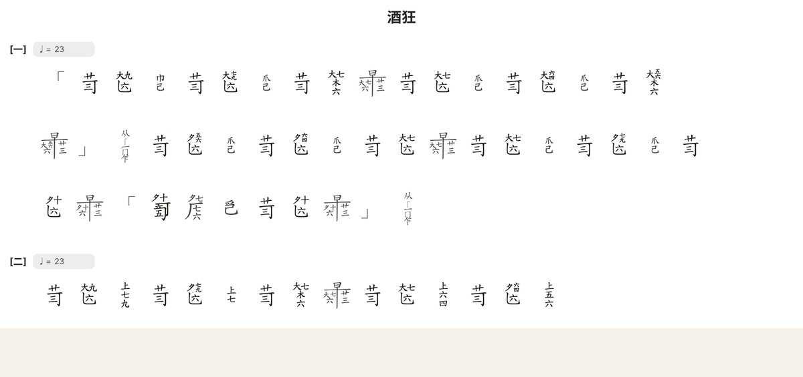
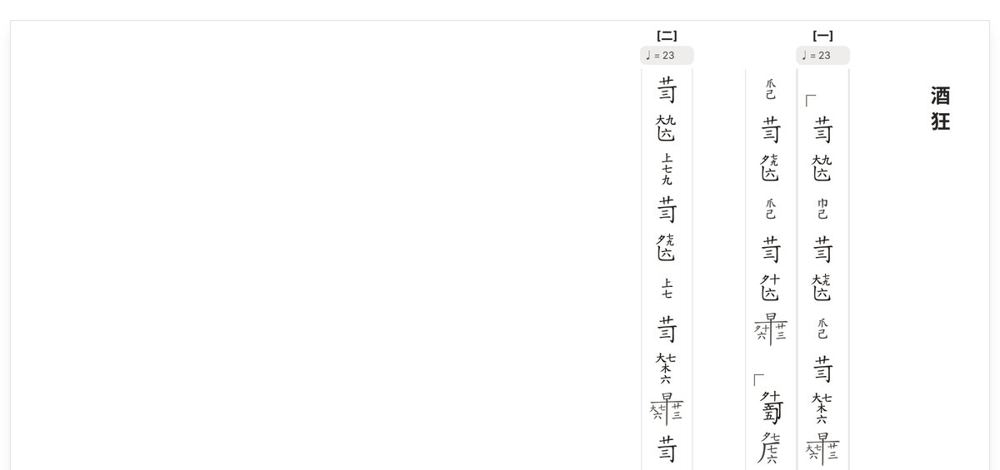
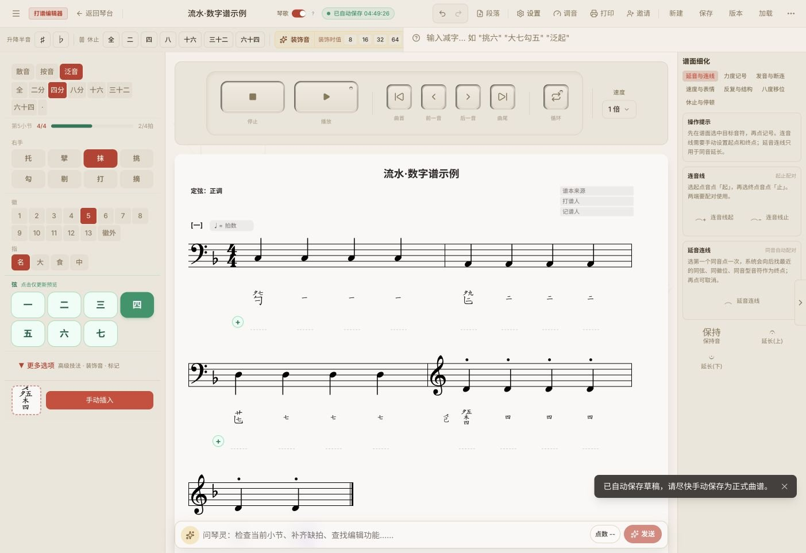
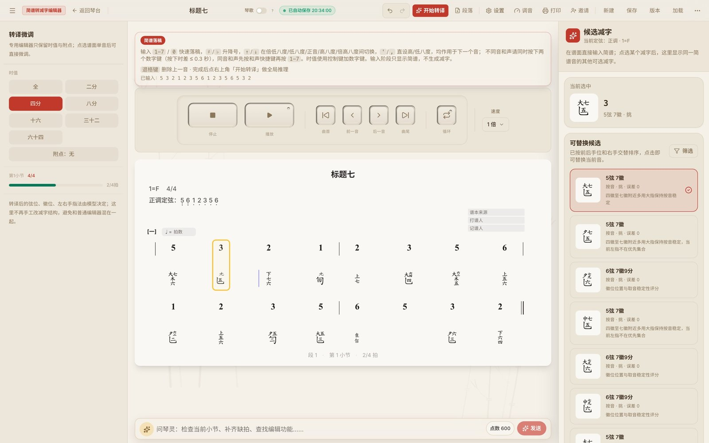
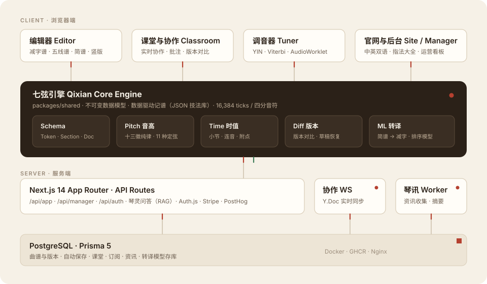
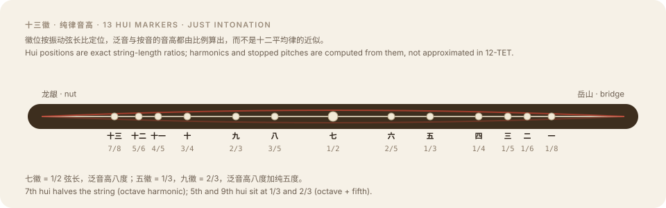

# Lingxian · 灵弦

**A notation editor for the guqin: write *jianzipu* tablature, and see staff notation and jianpu update alongside it.**

[**www.lingxian.app**](https://www.lingxian.app) &nbsp;·&nbsp; [Promo video](assets/video/lingxian-promo.mp4) &nbsp;·&nbsp; [Architecture](#architecture) &nbsp;·&nbsp; [Engineering highlights](#engineering-highlights)

> [!NOTE]
> This is the **public showcase** for Lingxian. The product source code is private; this repository holds the overview, the architecture and selected visuals.

  
   ▶ Click for the full promo video (68s)

## Why

The guqin has been written in **jianzipu** (减字谱) for over a thousand years. Each character packs string, hui position, left-hand finger, right-hand technique and ornaments into a single glyph. Yet the notation records no rhythm, so most players still copy and annotate scores by hand. Lingxian makes jianzipu something you can type, play back, compare, share and print.

## What it does

| | |
|---|---|
| **Jianzipu editor** | Type a character such as 「散勾三」 and it is drawn in jianzipu and on the staff at the same moment. Covers 37 performance techniques, compound techniques, ornaments, sections, durations, and **11 tunings × 5 modes** |
| **Four views of one score** | Jianzipu + staff · jianzipu + jianpu · pure jianzipu, horizontal · pure jianzipu, **vertical** (the traditional layout), with the same layout rules on screen and in the PDF |
| **Jianpu → jianzipu transcription** | Paste jianpu or import MusicXML, and the planner chooses strings, hui positions and fingerings for the whole piece; you can pick from ranked alternatives |
| **Collaboration & teaching** | Real-time co-editing, invitations, classrooms, per-character annotations, version history and diff |
| **Export** | PDF (title, sections, tuning, jianzipu + staff, numbered annotation footnotes) and MusicXML for MuseScore / Sibelius |
| **Tuner** | Real-time microphone pitch detection, with all seven strings tappable and audible |
| **Technique dictionary** | 149 entries with source quotations from historical handbooks, in Chinese and English |
| **Qinling assistant** | An in-editor helper that answers "how do I…" questions from a curated knowledge base |
| **Journal** | Essays on guqin history, technique and Chinese culture, in Chinese and English |

### One score, four views

<table>
  <tr>
    <td width="50%"> Jianzipu + staff</td>
    <td width="50%"> Jianzipu + jianpu</td>
  </tr>
  <tr>
    <td> Pure jianzipu · horizontal</td>
    <td> Pure jianzipu · vertical</td>
  </tr>
</table>

### The editor

### Jianpu → jianzipu transcription

## Architecture

A pnpm + Turborepo monorepo. The music logic lives in a shared **Qixian (七弦) core engine**: an immutable token model, a data-driven technique library in JSON, a pitch engine, a timing engine at 16,384 ticks per quarter note, and a version diff. The web app, the API and the background workers all build on it.

| Layer | Stack |
|---|---|
| Front end | Next.js 14 (App Router), React 18, TypeScript, Tailwind CSS, Zustand |
| Notation & audio | VexFlow 5, custom JianZiPu font rendering, jsPDF, Tone.js / Web Audio, AudioWorklet |
| Collaboration | Yjs (Y.Doc) over a dedicated WebSocket process |
| Data | PostgreSQL, Prisma 5 |
| Auth & payments | Auth.js (email / SMS / OAuth), Stripe |
| Quality | Vitest, Playwright (including WebKit runs) |
| Ops | Docker, GHCR, Nginx, PostHog (consent-gated) |

## Engineering highlights

### Transcription is path planning, not a lookup table

A single pitch on the guqin can be played on several strings, at several positions and with several fingers. So the planner enumerates every legal candidate (open, stopped and harmonic, across strings and hui) and runs a **beam search over the whole passage**. A stateful reasoner adds context costs: string distance, hui distance and left-hand finger continuity. A trained **ranking model** then re-orders the legal candidates; it never invents glyphs of its own. Recognised melodic shapes fold into ornaments (2-3-2 → 进复, 3-2-3 → 退复). Slides are added only when the source score marks them, so the planner never adds embellishment on the player's behalf.

### Pitch from string ratios: thirteen hui in just intonation

Hui positions are exact string-length ratios (1/8 … 1/2 … 7/8), and open, stopped and harmonic pitches are all computed from those ratios rather than snapped to 12-TET.

### Rendering a thousand-year-old script on the web

- Technique, ornament and fingering definitions are **data-driven JSON**. Adding a technique is a data change, and the editor, the technique dictionary and the PDF exporter all read the same configuration.
- Jianzipu glyphs are built from OpenType ligatures. WebKit skips DOM text runs whose total advance is zero, so some characters showed up as blank cells on iPad. The editor measures each run on a canvas and pads only the zero-advance ones with a hair space, leaving the geometry unchanged.
- The vertical layout computes cell heights per character, and the editor and the PDF exporter share the same pure layout functions.

### Real-time tuner DSP

The pipeline runs AudioWorklet pre-processing (DC blocker, high-pass filter) → YIN fundamental-frequency detection → confidence fusion → octave-candidate scoring that includes harmonic modes → Viterbi smoothing.

### Built to be trusted with people's scores

- Autosave writes back to the score record in a single transaction. On re-open, newer autosaves are restored silently and the editor says what changed.
- Score content passes through a single de-identification step before it reaches the transcription model's training pool.
- Product analytics start only after the user consents, and they record actions and counts, never score content.

## By the numbers

- Started **February 2026**. Over **1,200 commits** since.
- About **2,100 TypeScript files**, of which **570+ are test files**.
- **149** technique dictionary entries · **37** performance techniques · **11** tunings.

---

© Lingxian 灵弦. All rights reserved. Screenshots, video and visuals in this repository may not be reused without permission. 
<a href="https://www.lingxian.app">www.lingxian.app</a>

